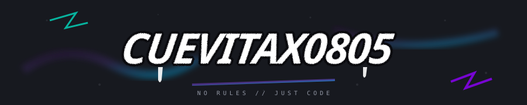

# 💻 TECNOLOGÍAS Y CONOCIMIENTOS

---

### ⌨️ LENGUAJES DE PROGRAMACIÓN

---

### 🌐 DESARROLLO WEB

---

### 🗄️ BASES DE DATOS

---

### ⚙️ HERRAMIENTAS

---

  

 Aprendiendo · Practicando · Construyendo 

